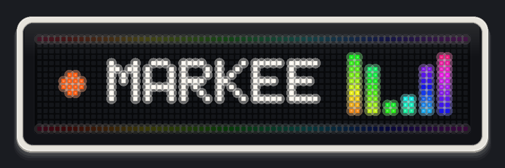

# markee

A C11 + [raylib](https://www.raylib.com/) desktop simulator for a **72×16, 24-bit RGB LED matrix display**, inspired by the [BUSY Bar](https://busy.app/products/busy-bar).

`markee` renders the LED panel inside a molded plastic enclosure calibrated to appear **~6.35 inches wide** on screen, refreshes at **60 Hz**, and exposes a lightweight **HTTP/1.1 API** so any script or program can draw shapes and scrolling text, push 72×16 PNGs or raw 24-bit RGB frames, trigger gentle alert chimes, and read back the current display as a PNG.



## Inspiration

`markee` began as a quick software take on the [BUSY Bar](https://busy.app/products/busy-bar)—built to get a feel for how a small, glanceable desk LED bar works in practice and what's fun to drive on it.

It is an independent hobby project, not a BUSY Bar emulator. Its HTTP API is intentionally minimal and is **not compatible** with the official BUSY Bar API or [busylib](https://busy-app.github.io/busylib-py/). For the actual hardware and official SDK, see the [BUSY Bar product page](https://busy.app/products/busy-bar) and the [busylib documentation](https://busy-app.github.io/busylib-py/).

## Features

- **72×16 true-color LED matrix** — 24-bit RGB per pixel, customizable from `1×1` to `1024×1024` via `--resolution`
- **True-to-size desk rendering** — reads monitor EDID dimensions to scale the matrix to ~6.35 inches wide (overridable with `--dpi` and `--zoom`), framed in a molded off-white PC/ABS shell, smoked polycarbonate faceplate, square or circular LED dies, and soft glow halos at **60 Hz**
- **Simple HTTP/1.1 API (Keep-Alive + open CORS)** — works out of the box with `curl`, Python, browser `fetch()`, Node.js, Go, or raw sockets:
  - **Atomic drawing (`POST /draw`):** batch `clear`, `pixel`, `line`, `rect` (with corner radius), `oval`, `polygon`, bitmap `text` (3 built-in fonts + smooth 60 Hz marquee scrolling), and placed `image` sprites (PNGs and static/animated GIFs)
  - **Frame I/O (`/frame`):** upload or read back lossless `W×H` PNGs, or stream raw 24-bit RGB (`3,456` bytes at 72×16) at 60 FPS
  - **Pixels & panel controls:** read/set individual pixels, solid fills, clear, GUI brightness (`0–100%`), and a non-destructive BT.709 monochrome phosphor tint filter
- **Built-in gentle alert sounds (`/alert`)** — 3 procedurally synthesized, non-startling chimes (`ding`, `chime`, `bell`) with volume control and overlapping playback; zero external audio files required
- **Headless mode** — run `--headless` for scripts, daemons, and CI without opening a window

## Quick start

Install `raylib` (see [Building](#building)), then build and launch:

```bash
make run
```

In another terminal, draw a status banner and play a gentle chime:

```bash
curl -X POST http://127.0.0.1:8080/draw -d '[
  { "op": "clear" },
  { "op": "rect", "x": 0, "y": 0, "w": 72, "h": 16, "color": "orange", "radius": 3 },
  { "op": "oval", "x": 4, "y": 4, "w": 8, "h": 8, "fill": "green" },
  { "op": "text", "x": 16, "y": 4, "text": "READY", "color": "warmwhite" }
]'

curl -X POST http://127.0.0.1:8080/alert/chime
curl -o capture.png http://127.0.0.1:8080/frame
```

## Building

### Prerequisites

- A C11 compiler (`cc`, `clang`, or `gcc`) and `make`
- `raylib` (5.x or 6.x) and `pkg-config`

**Install `raylib`:**

| Platform | Command |
|---|---|
| macOS (Homebrew) | `brew install raylib pkg-config` |
| Ubuntu / Debian | `sudo apt install build-essential pkg-config libraylib-dev` |
| Arch Linux | `sudo pacman -S base-devel raylib pkgconf` |

### Make targets

| Command | Description |
|---|---|
| `make` | Build `./markee` (`-O2`) |
| `make run` | Build and launch `./markee` |
| `make test` | Build and run the C unit & socket API test suite (`./test_api`) |
| `make debug` / `make release` | Clean rebuild with `-O0 -g` or `-O3` |
| `make install` / `make uninstall` | Install or remove in `~/.local/bin` (falls back to `/usr/local/bin`; override with `PREFIX=` / `DESTDIR=`) |
| `make clean` / `make distclean` | Remove build artifacts (`distclean` also deletes `snapshot.png`) |
| `make help` | List all targets |

`Makefile` locates `raylib` via `pkg-config` and falls back to standard Homebrew/Linux flags if unavailable. Pass `CC=clang` or `CC=gcc` to pick a specific compiler.

## Usage

```bash
./markee [options]
```

On startup, `markee` prints its bound address and main endpoints:

```text
markee (72x16, zoom=1.00x, pixels=square) API listening on http://127.0.0.1:8080
```

Quit at any time with `Ctrl+C` (`SIGINT`), `SIGTERM`, `Q`/`ESC`, or by closing the window.

### CLI options

| Flag | Description | Default |
|---|---|---|
| `-r, --resolution <WxH>` | Matrix dimensions in LEDs (`1..1024` per axis, e.g. `128x32`, `64x64`) | `72x16` |
| `-z, --zoom <factor>` | Window zoom multiplier (`0.1..10.0`) | `1.0` |
| `--square`, `--circle` | Render LEDs as squares or circles | `--square` |
| `-s, --shape <style>` | Pixel shape: `square` or `circle` | `square` |
| `-m, --monochrome <color>` | Start with the BT.709 monochrome tint filter on (`#rrggbb`, `0xrrggbb`, `#rgb`, or a [color name](docs/API.md#color-formats) like `amber`). Alias: `--mono` | Off |
| `-H, --host <addr>` | Bind address: IPv4, IPv6 (`::1`, `::`), or hostname (`localhost`). Note: the API has **no authentication** | `127.0.0.1` |
| `-p, --port <port>` | TCP port (`0..65535`; `0` picks a free ephemeral port). Overrides `MARKEE_PORT` | `8080` (or `$MARKEE_PORT`) |
| `--dpi <value>` | Override monitor logical DPI (`> 0`) if EDID physical sizing is wrong | Auto-detected (fallback `110`) |
| `--always-on-top` | Keep the GUI window floating above other windows. Alias: `--topmost` | Off |
| `--borderless` | Floating widget mode: hide OS titlebar, transparent backdrop, drag enclosure to move. Alias: `--frameless` | Off |
| `--position <X,Y>` | Initial window position in screen pixels (e.g. `100,60`). Alias: `--pos` | Centered |
| `--corner <place>` | Snap initial window to a monitor corner or edge: `center`, `top-left` (`tl`), `top-right` (`tr`), `bottom-left` (`bl`), `bottom-right` (`br`), `top`, `bottom` | `center` |
| `--case <theme>` | Enclosure color theme: `white`, `charcoal` (`black`/`dark`), `orange`, `retro` (`beige`) | `white` |
| `--idle-dim <sec>` | Automatically dim GUI brightness after `sec` seconds with no API writes or input | Off (`0`) |
| `--idle-brightness <0..100>` | Dimmed GUI brightness level used by `--idle-dim` | `20` |
| `--demo` | Start with the built-in 60 Hz demo animation instead of a blank display | Off |
| `--mute` | Disable alert sound playback. Alias: `--no-audio` | Off |
| `--headless` | Run the API server without a GUI window (60 Hz demo, scrolling text, `GET /frame`, and alert audio still run) | Off |
| `-h, --help` | Show usage and keyboard shortcuts, then exit | — |

**Examples:**

```bash
./markee                             # Default 72x16 blank display (~6.35" wide)
./markee --demo                      # Launch with the built-in demo animation
./markee --circle --zoom 2           # Circular LEDs at 2x size
./markee -r 128x32 -z 0.75           # Custom 128x32 matrix at 0.75x zoom
./markee -m amber                    # Amber phosphor monochrome look
./markee --headless --mute -p 0      # Silent API-only mode on any free port (CI/scripts)
```

### Keyboard shortcuts

Available when running in GUI mode:

| Key | Action |
|---|---|
| `1` / `2` / `3` | Preview the 3 built-in alert sounds (`ding`, `chime`, `bell`; keypad `1–3` also work) |
| `C` | Clear display to black |
| `D` | Toggle the built-in demo animation |
| `K` | Cycle enclosure color theme (`white` / `charcoal` / `orange` / `retro`) |
| `M` | Toggle the monochrome filter (reuses last tint color, or amber `#ffbf00`) |
| `P` | Toggle pixel shape (`square` / `circle`) |
| `S` | Save current frame to `snapshot.png` in the working directory (includes monochrome filter if on) |
| `T` | Toggle always-on-top window mode |
| `SPACE` / `ENTER` | Emit an `action` button event on `GET /events` |
| `+` (`=`) / `-` | Increase or decrease simulated brightness by 10% (keypad `+`/`-` also work) |
| `Q` / `ESC` | Quit |

## HTTP API

`markee` serves an HTTP/1.1 API on `http://127.0.0.1:8080` by default, with persistent Keep-Alive connections and open CORS. Any write to the framebuffer automatically stops the demo animation if it is running.

**See [`docs/API.md`](docs/API.md) for the complete reference**—including every parameter, draw op, font, scrolling rule, color format, protocol limit, and client recipe.

| Method | Path | Purpose |
|---|---|---|
| `GET` | [`/info`](docs/API.md#get-info) | Resolution, settings, audio readiness, frame counter |
| `GET` | `/ui` | Built-in Web Playground (live LED preview, `/draw` JSON editor, drag-and-drop GIF/PNG, alerts) |
| `POST` `PUT` | [`/draw`](docs/API.md#post-draw) | Atomic JSON batch of `clear`, `pixel`, `line`, `rect`, `oval`, `polygon`, `text`, and `image` ops (optional `?ttl=<sec>`) |
| `GET` `POST` `PUT` `DELETE` | [`/notify`](docs/API.md#post-notify) | Show a temporary notification banner/batch for `ttl` seconds, then auto-restore prior screen |
| `GET` | [`/frame`](docs/API.md#get-frame) | Read displayed pixels as a PNG (`/frame.rgb` or `?format=raw` for raw RGB24) |
| `POST` `PUT` | [`/frame`](docs/API.md#post-frame) | Replace the frame with a `W×H` PNG or `W×H×3` raw RGB24 bytes (`/frame.rgb`) |
| `GET` `POST` `PUT` `DELETE` | [`/animate`](docs/API.md#animated-gifs) | Play, inspect, or stop an animated GIF (crop/center to fit; optional `?fill=<color>` and `?loop=<n>`) |
| `POST` | [`/clear`](docs/API.md#delete-frame-post-clear) | Clear to black (also `DELETE /frame`) |
| `POST` | [`/fill`](docs/API.md#post-fill) | Fill the entire display with one color |
| `GET` `POST` `PUT` | [`/pixel`](docs/API.md#pixels) | Read or set a single pixel |
| `GET` `POST` `PUT` | [`/brightness`](docs/API.md#post-brightness) | Read or set GUI LED brightness (`0–100`; readback unaffected) |
| `GET` `POST` `PUT` `DELETE` | [`/monochrome`](docs/API.md#post-monochrome) | Read or toggle the non-destructive BT.709 tint filter |
| `POST` | [`/demo`](docs/API.md#post-demo) | Turn the built-in demo animation on or off |
| `GET` `POST` | [`/alert`](docs/API.md#alert-sounds) | List or play the 3 gentle alert sounds (`POST /alert/1`..`3` or `ding`/`chime`/`bell`) |
| `GET` `POST` | [`/events`](docs/API.md#get-events) | Poll or stream (SSE) LED clicks, bezel/key button presses, and frame updates |

### More `curl` examples

```bash
# Scrolling ticker (place the scrolling text op last)
curl -X POST http://127.0.0.1:8080/draw -d '[
  { "op": "clear" },
  { "op": "text", "x": 72, "y": 4, "text": "Hello from markee", "color": "amber", "scroll": true, "speed": 30 }
]'

# Solid fill & single pixel (use 0x or bare hex in URLs—clients strip "#..." fragments)
curl -X POST "http://127.0.0.1:8080/fill?color=0xf25c19"
curl -X POST "http://127.0.0.1:8080/pixel?x=12&y=8&color=0x00ffb4"

# Upload a 72x16 PNG
curl -X POST --data-binary @frame.png http://127.0.0.1:8080/frame

# Amber monochrome tint on, then off
curl -X POST http://127.0.0.1:8080/monochrome -d amber
curl -X DELETE http://127.0.0.1:8080/monochrome

# Adjust brightness, play a soft bell at 70% volume, inspect status
curl -X POST "http://127.0.0.1:8080/brightness?value=60"
curl -X POST "http://127.0.0.1:8080/alert/bell?volume=70"
curl http://127.0.0.1:8080/info
```

> **Colors:** every color endpoint accepts `0xff5500`, `ff5500`, `#ff5500`, 3-digit shorthand (`0xf50`), and named colors (`amber`, `warmwhite`, `teal`, etc.). In query strings, avoid raw `#` (use `0x`, bare hex, or `%23`). See [Color formats](docs/API.md#color-formats).

### Python client example

A zero-dependency Python 3 client is included in [`examples/demo.py`](examples/demo.py). With `./markee` running:

```bash
python3 examples/demo.py --seconds 8 --save readback.png
```

Minimal stdlib-only PNG upload and readback:

```python
import urllib.request

with open("frame.png", "rb") as f:
    req = urllib.request.Request(
        "http://127.0.0.1:8080/frame",
        data=f.read(),
        headers={"Content-Type": "image/png"},
        method="POST",
    )
    urllib.request.urlopen(req)

png_bytes = urllib.request.urlopen("http://127.0.0.1:8080/frame").read()
with open("screen.png", "wb") as f:
    f.write(png_bytes)
```

## Testing

```bash
make test
```

Builds and runs `./test_api` with no GUI window and silent audio. The suite covers physical layout sizing, framebuffer/PNG round-trips, BT.709 monochrome filtering, unified color parsing, synthesized alert PCM quality, and live socket integration tests over an ephemeral localhost port (Keep-Alive, raw RGB24, custom resolutions, atomic `/draw`, `/alert`, and HTTP error handling).

## Project structure

```text
markee/
├── Makefile             # Build, test, run, install, clean targets (`make help`)
├── README.md            # Overview, build, and CLI usage
├── docs/
│   ├── API.md           # Complete HTTP API reference and recipes
│   └── demo.png         # Screenshot of markee running in --demo mode
├── include/
│   ├── audio.h          # Procedural alert sound synthesis (ding/chime/bell) and playback queue
│   ├── config.h         # Display defaults and HTTP limits (72x16, 6.35", 60 Hz, body/header caps)
│   ├── display.h        # Thread-safe 24-bit framebuffer, PNG I/O, brightness/monochrome/demo state
│   ├── draw.h           # Color parsing, bitmap fonts, atomic /draw JSON executor
│   ├── json.h           # Minimal recursive-descent JSON parser for API request bodies
│   ├── renderer.h       # Monitor DPI sizing and molded-enclosure LED renderer
│   └── server.h         # Embedded POSIX TCP/HTTP server
├── src/
│   ├── main.c           # CLI parsing, lifecycle, 60 Hz main loop, GUI hotkeys
│   ├── audio.c          # Additive bell/chime PCM synthesis and polyphonic raylib playback
│   ├── display.c        # Framebuffer, PNG encode/decode, BT.709 monochrome filter, demo & scroller
│   ├── draw.c           # Shape rasterizers (pixel/line/rect/oval/polygon), 5x7 & 3x5 fonts, /draw
│   ├── json.c           # JSON parser implementation
│   ├── renderer.c       # 6.35" calibration, molded enclosure, diffused LED & glow rendering
│   └── server.c         # Thread-per-connection HTTP/1.1 Keep-Alive server and route handlers
├── examples/
│   └── demo.py          # Zero-dependency Python demo: /info, PNG round-trip, 60 FPS raw stream
└── tests/
    └── test_api.c       # Unit and live socket API integration tests (`make test`)
```

## License

[MIT](LICENSE) © 2026 Steven Spencer
